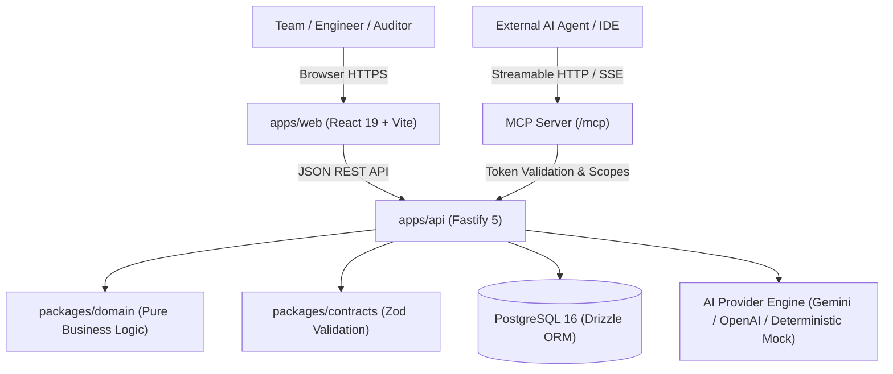

<div align="center">

# 🚀 Vouchlock

### _Turn project briefs into actionable, collaborative plans and verified delivery records._

[](https://www.typescriptlang.org/)
[](https://fastify.dev/)
[](https://react.dev/)
[](https://orm.drizzle.team/)
[](https://vitest.dev/)
[](https://modelcontextprotocol.io/)
[](./docs/decisions.md)

[Why Vouchlock?](#-why-vouchlock) •
[Key Features](#-key-features) •
[Architecture](#️-architecture) •
[Quick Start](#-quick-start) •
[Testing](#-testing--verification) •
[Agentic Assistant](#-agentic-project-assistant) •
[API Reference](#-api-reference) •
[Security](#-security--privacy)

</div>

---

## 💡 Why Vouchlock?

Most project management tools jump straight into to-do lists without clarifying requirements or proving what was actually shipped. **Vouchlock** is **"The Delivery Ledger"** — the single source of truth connecting an incoming brief to daily execution and explicit proof:

```text
┌──────────────┐      ┌────────────────────────┐      ┌────────────────────┐      ┌─────────────────┐      ┌─────────────────────────┐
│ Source Brief │ ───► │ Reviewed Requirements  │ ───► │ Linked Code Tasks  │ ───► │ Proof Artifacts │ ───► │ Truthful Delivery Audit │
└──────────────┘      └────────────────────────┘      └────────────────────┘      └─────────────────┘      └─────────────────────────┘
```

- 🎯 **Clarity Before Activity:** AI parses incoming briefs to extract candidate requirements, assumptions, and risks into a structured roadmap.
- 🛡️ **Zero Phantom Mutations:** AI never writes directly to your production project. Generated plans and extracted requirements are proposed as candidate envelopes requiring human review and explicit acceptance.
- 📜 **The Delivery Ledger:** Requirements connect to code tasks, tasks connect to real proof artifacts (PRs, test logs, audit documents), and named engineers certify the record.
- 🤝 **Multi-Tenant Collaboration:** Role-based permissions (`owner`, `admin`, `member`), secure 7-day invite tokens, and immutable verification audit trails.
- 🤖 **Agentic Project Intelligence:** Autonomous Copilot analyzes project records, surfaces evidence gaps and blockers, and prepares concrete changes requiring explicit human review and approval.

---

## 🌟 Key Features

| Feature | Description |
| :--- | :--- |
| **✨ AI Brief Decomposition** | Turns project briefs, RFPs, or client statements into structured milestones, tasks, risks, and candidate requirements with source quote citations. |
| **🤖 Agentic Project Copilot** | Grounded project reasoning with human-in-the-loop approvals. Strictly segregates verified facts from model inferences; zero autonomous unreviewed writes. |
| **🔑 Secure BYOK Providers** | User-managed tested providers (Google Gemini & OpenAI; Mock deterministic fallback). Authenticated server-side encryption with AES-256-GCM. Never leaked. |
| **🔌 Standard MCP Server** | Official `@modelcontextprotocol/sdk` Streamable HTTP server at `/mcp` with scoped cryptographic tokens, rate/concurrency limits, and read-only audit tools. |
| **📑 Requirements & Traceability** | Expandable ledger rows with vertical traceability chains: _Requirement Claim_ → _Linked Tasks_ → _Proof Artifacts_ → _Human Attestation Stamp_. |
| **📋 5-Column Horizontal Kanban** | Equal-width horizontal board (`Backlog`, `To Do`, `In Progress`, `Blocked`, `Done`) with card lift, blocker alerts, and accessible keyboard move alternatives. |
| **📊 Truthful Delivery Reports** | Client-ready printable attestation documents featuring delivery verdicts, tabular metric registers, claims-vs-proof matrix, and formal sign-off blocks. |
| **👥 Executive Briefing Dashboard** | Single-row state-of-delivery metric strip across all projects, ruled Projects ledger table, and compact team roster with plain-text roles. |
| **📥 Full Data Portability** | One-click JSON exports for projects, tasks, comments, and workspace audit trails. |

---

## 🏗️ Architecture

Vouchlock is organized as a high-performance **pnpm monorepo** with strict boundary separation:

```text
ProjectPilot/
├── packages/
│   ├── 📦 domain/        # Pure business rules (zero external dependencies, zero I/O)
│   │                     # Role matrix, status transitions, invite lifecycle, plan validation
│   └── 📑 contracts/     # Shared Zod schemas for all API payloads, responses, and errors
├── apps/
│   ├── ⚡ api/           # High-throughput Fastify REST API + Drizzle ORM + PostgreSQL
│   │                     # JWT cookie auth, AES-256-GCM BYOK encryption, Copilot & MCP servers
│   └── 🎨 web/           # Modern React 19 SPA + Vite
│                         # Delivery Ledger design, 5-column Kanban, TaskDrawer, Agent Copilot Card
└── docs/
    └── 📝 decisions.md   # Architectural Decision Records (ADRs) and feasibility reports
```

### System Flow Diagram



---

## ⚡ Quick Start

### 1. Prerequisites

- **Node.js** ≥ 20.x (`node -v`)
- **pnpm** ≥ 9.x (`npm install -g pnpm`)
- **PostgreSQL** 16+ or **Docker & Docker Compose**

### 2. Installation & Database Setup

```bash
# Clone the repository
git clone [https://github.com/Sonesh-2202/ProjectPilot.git](https://github.com/Sonesh-2202/ProjectPilot.git)
cd ProjectPilot

# Install all workspace dependencies
pnpm install

# Option A: Start PostgreSQL via Docker Compose
docker compose up -d

# Option B: Native PostgreSQL (if Docker is unavailable)
# Ensure PostgreSQL is running on port 5432 and create the databases:
createdb -h 127.0.0.1 -p 5432 -U postgres projectpilot
createdb -h 127.0.0.1 -p 5432 -U postgres projectpilot_test

# Configure environment
cp .env.example .env
# Set DATABASE_URL in .env (e.g. postgresql://postgres@localhost:5432/projectpilot)

# Build shared TypeScript libraries
pnpm run build:packages

# Apply database migrations to main and test databases
pnpm run db:migrate
DATABASE_URL="postgresql://postgres@localhost:5432/projectpilot_test" pnpm run db:migrate
```

### 3. Run Development Servers

```bash
# Terminal 1: Start Fastify backend on http://localhost:3001
pnpm dev:api

# Terminal 2: Start React frontend on http://localhost:5173
pnpm dev:web
```

---

## 🧪 Testing & Verification

The repository enforces strict test automation, type safety, and runtime verification across all packages:

```bash
# Run all automated tests across domain, contracts, api, and web
# (API integration tests require a running PostgreSQL instance)
pnpm test

# Run unit tests offline without PostgreSQL
pnpm run test:unit

# Run strict TypeScript typecheck across all packages (0 errors)
pnpm typecheck

# Full CI validation (typecheck + lint + format:check + test)
pnpm check

# Run end-to-end full-stack smoke test workflow (requires PostgreSQL)
pnpm run smoke

# Verify PostgreSQL backup & restore integrity with populated data
pnpm run db:backup-verify:populated

# Verify production builds
pnpm -r run build
```

### Test Coverage Highlights

| Suite | Scope |
| :--- | :--- |
| **`@projectpilot/domain`** | Status transitions, member removals, role hierarchy, date boundaries, plan draft validation. |
| **`@projectpilot/contracts`** | Zod input parsing, string sanitization, UUID constraints, MCP scope enum, MCP pagination schemas, concurrency tokens. |
| **`@projectpilot/api`** | MCP server, BYOK registry, Copilot, planner, Gemini adapter, security, persistence, and workflow integration. |
| **`@projectpilot/web`** | Web API recovery, settings flows, UI contract adherence, and navigation. |

---

## 🤖 Agentic Project Assistant

Vouchlock features an agentic project delivery assistant designed to turn unstructured briefs into actionable work while enforcing absolute human-in-the-loop safety:

### Core Principles

1. **Grounded Context:** Reads authorized project records (brief revisions, requirements, milestones, tasks, evidence, blockers, and evidence gaps) within the authenticated workspace.
2. **Explicit Fact vs. Inference Separation:** Project facts are derived from database records; model inferences, suggestions, and proposed actions are strictly labeled as unverified until human review.
3. **Proposal-Before-Write Pattern:** The agent **never** autonomously writes to your production database. Instead, it generates a structured `ProposedAction` with a deterministic SHA-256 `proposalId`.
4. **Interactive Human Approval:** A team lead or project member reviews the proposed action (creating tasks, milestones, evidence collection, or requirement updates) and clicks **Approve** or **Reject**. Only explicit approval triggers the state mutation.
5. **Full Audit Traceability:** Every agent analysis, approved action, and rejected proposal is immutably logged in `auditEvents` with actor ID, timestamp, and entity references.

### Bring-Your-Own-Key (BYOK) Security

- **Supported Providers:** Google Gemini (`gemini-3.8-flash`), OpenAI (`gpt-4o`, `gpt-4o-mini`), and a deterministic offline Mock provider.
- **Authenticated Server Encryption:** User keys are encrypted with AES-256-GCM using a server-side secret (`ENCRYPTION_SECRET` or derived from `JWT_SECRET`).
- **Zero Key Leakage:** Keys are never returned in full to the client (only masked suffixes like `...1234`), never stored in browser `localStorage` or cookies, and never included in error logs or analytics.
- **Session Scoping & Expiry:** Keys are isolated per-user and per-workspace with an explicit TTL and instant revocation.

### Model Context Protocol (MCP)

Vouchlock exposes a standard Model Context Protocol (MCP) server over Streamable HTTP at `/mcp`:

- **Read-Only Defaults:** Tools (`get_project_summary`, `list_requirements`, `list_tasks`, `get_delivery_report`) provide bounded inspection of project status.
- **Cryptographic Tokens:** MCP tokens are generated with an `mcp_` prefix and stored as SHA-256 hashes.
- **Safety Bounds:** Per-session rate limits and concurrency bounds (max 3 concurrent calls) prevent abuse.

---

## 📡 API Reference

All endpoints return JSON wrapped in an error envelope upon failure: `{ error: { code, message, details } }`.

<details open>
<summary><b>🔐 Authentication & Sessions</b></summary>
<br>

| Method | Endpoint | Description |
| :--- | :--- | :--- |
| `POST` | `/api/v1/auth/register` | Register new user account |
| `POST` | `/api/v1/auth/login` | Sign in & receive HTTP-only session cookie |
| `POST` | `/api/v1/auth/logout` | Revoke session & clear cookies |
| `GET` | `/api/v1/auth/me` | Return active authenticated user profile |

</details>

<details>
<summary><b>🏢 Workspaces & Collaboration</b></summary>
<br>

| Method | Endpoint | Description |
| :--- | :--- | :--- |
| `GET` | `/api/v1/workspaces` | List current user's workspaces |
| `POST` | `/api/v1/workspaces` | Create workspace (creator becomes `owner`) |
| `GET` | `/api/v1/workspaces/:id` | Workspace details & member directory |
| `POST` | `/api/v1/workspaces/:id/invitations` | Generate secure 7-day invite token |
| `POST` | `/api/v1/workspaces/invitations/:token/accept` | Accept invitation link |
| `DELETE` | `/api/v1/workspaces/:id/members/:userId` | Remove member (last owner protected) |
| `GET` | `/api/v1/workspaces/:id/export` | Full workspace data export (JSON) |

</details>

<details>
<summary><b>📁 Projects & Brief Intake</b></summary>
<br>

| Method | Endpoint | Description |
| :--- | :--- | :--- |
| `GET` | `/api/v1/workspaces/:wid/projects` | List projects in workspace |
| `POST` | `/api/v1/workspaces/:wid/projects` | Create project with goal and constraints |
| `GET` | `/api/v1/projects/:id` | Project brief, milestones, and tasks |
| `PATCH` | `/api/v1/projects/:id` | Update project brief with concurrency checks |
| `GET` | `/api/v1/projects/:id/briefs` | List versioned source brief revisions |
| `POST` | `/api/v1/projects/:id/briefs` | Create new source brief revision |
| `POST` | `/api/v1/projects/:id/proposals/extract` | Extract candidate requirements from brief |
| `POST` | `/api/v1/projects/:id/proposals/accept` | Accept candidate requirements into project |
| `POST` | `/api/v1/projects/:id/plan-drafts` | **AI Plan Generator** (non-mutating proposal) |
| `POST` | `/api/v1/projects/:id/plan-drafts/:draftId/accept` | **Accept Plan** (atomic transaction) |
| `POST` | `/api/v1/projects/:id/ai/progress-summary` | Read-only delivery progress analysis |
| `GET` | `/api/v1/projects/:id/export` | Complete project export (JSON) |

</details>

<details>
<summary><b>📑 Requirements, Evidence & Verification</b></summary>
<br>

| Method | Endpoint | Description |
| :--- | :--- | :--- |
| `GET` | `/api/v1/projects/:id/requirements` | List requirements with linked tasks & evidence counts |
| `POST` | `/api/v1/projects/:id/requirements` | Register requirement claim |
| `GET` | `/api/v1/requirements/:id` | Requirement detail, task links, evidence, and verifications |
| `POST` | `/api/v1/requirements/:id/tasks/:taskId` | Link task to requirement |
| `DELETE` | `/api/v1/requirements/:id/tasks/:taskId` | Unlink task from requirement |
| `POST` | `/api/v1/requirements/:id/evidence` | Attach proof artifact (URL or note) |
| `POST` | `/api/v1/requirements/:id/verify` | Human attestation sign-off (`verified`, `rejected`, `unverified`) |
| `GET` | `/api/v1/projects/:id/delivery-report` | Compute Truthful Delivery Report and audit metrics |

</details>

<details>
<summary><b>✅ Tasks & Milestones</b></summary>
<br>

| Method | Endpoint | Description |
| :--- | :--- | :--- |
| `POST` | `/api/v1/projects/:id/milestones` | Create milestone |
| `PATCH` | `/api/v1/projects/milestones/:id` | Update milestone dates / title |
| `DELETE` | `/api/v1/projects/milestones/:id` | Delete milestone |
| `POST` | `/api/v1/tasks/projects/:pid/tasks` | Create task |
| `GET` | `/api/v1/tasks/:id` | Task details with threaded comments |
| `PATCH` | `/api/v1/tasks/:id` | Update task status or priority |
| `POST` | `/api/v1/tasks/:id/comments` | Add comment to task |

</details>

<details>
<summary><b>🤖 Standalone Copilot (Bounded Read → Propose → Approve)</b></summary>
<br>

| Method | Endpoint | Description |
| :--- | :--- | :--- |
| `POST` | `/api/v1/copilot/reports` | Generate bounded project analysis, open questions, risks, and proposed action envelopes |
| `POST` | `/api/v1/copilot/approve` | Execute action with human approval gate, permission check & content-hash verification |
| `POST` | `/api/v1/copilot/reject` | Record explicit rejection with reason in immutable audit trail |

</details>

<details>
<summary><b>🔑 Bring Your Own Key (BYOK) Providers</b></summary>
<br>

| Method | Endpoint | Description |
| :--- | :--- | :--- |
| `GET` | `/api/v1/me/providers/available` | List tested/configured AI providers (`mock` & `openai` supported; `anthropic` gated) |
| `GET` | `/api/v1/me/providers` | List active ephemeral session status (masked keys only, zero plaintext) |
| `POST` | `/api/v1/me/provider-test` | Test provider credentials before session activation |
| `POST` | `/api/v1/me/providers` | Set ephemeral session API key (in-memory only, 24h TTL, wiped on logout) |
| `DELETE` | `/api/v1/me/providers/:provider` | Clear ephemeral provider session key |

</details>

<details>
<summary><b>🔌 Model Context Protocol (MCP) Server</b></summary>
<br>

| Method | Endpoint | Description |
| :--- | :--- | :--- |
| `ALL` | `/mcp` | Official `@modelcontextprotocol/sdk` Streamable HTTP transport endpoint |
| `GET` | `/mcp/v1/tools` | REST tool discovery endpoint (lists 4 read-only Vouchlock audit tools) |
| `POST` | `/mcp/v1/call` | REST tool invocation (`get_project_summary`, `list_requirements`, `list_tasks`, `get_delivery_report`) |
| `GET` | `/mcp/v1/tokens` | List caller's active MCP tokens for workspace |
| `POST` | `/mcp/v1/tokens` | Generate scoped MCP token (one-time reveal; SHA-256 hash stored; `mcp:admin` requires workspace owner/admin) |
| `POST` | `/mcp/v1/revoke` | Revoke MCP token (enforces caller ownership; prevents cross-user revocation) |

</details>

---

## 🔒 Security & Privacy

- **Default Deny:** Every database operation checks workspace membership and role permissions before executing.
- **Cross-Tenant Guard:** Attempting to query or mutate an unauthorized entity returns `404 Not Found` to prevent entity enumeration.
- **Session Protection:** Session tokens are stored in `HttpOnly`, `SameSite=Lax` cookies with 7-day expiration.
- **Credential Storage:** Passwords hashed using `bcrypt` / `argon2id`; invite tokens stored as one-way SHA-256 hashes.
- **Redacted Logging:** Pino logger automatically scrubs passwords, tokens, cookies, and `Authorization` headers from application logs.

---

## 📄 License

**Founder-controlled.** Project delivery and traceability suite with agentic intelligence. See [decisions.md](./docs/decisions.md) for architectural records.

<div align="center">
  <sub>Built with precision by <a href="https://github.com/Sonesh-2202">Sonesh-2202</a> • <b>ProjectPilot / Vouchlock</b></sub>
</div>