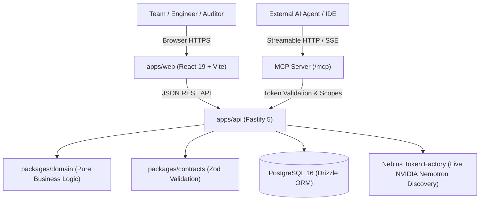

<div align="center">

# 🚀 Vouchlock

### _Turn project briefs into actionable, collaborative plans and verified delivery records._

[](https://www.typescriptlang.org/)
[](https://fastify.dev/)
[](https://react.dev/)
[](https://orm.drizzle.team/)
[](https://tokenfactory.nebius.com/)
[](https://build.nvidia.com/)
[](https://modelcontextprotocol.io/)
[](./docs/decisions.md)

[Why Vouchlock?](#-why-vouchlock) •
[Hackathon Updates](#-hackathon-updates-nebius-x-nvidia) •
[Key Features](#-key-features) •
[Architecture](#️-architecture) •
[Quick Start](#-quick-start) •
[Agentic Delivery Agent](#-agentic-delivery-agent-nvidia-nemotron) •
[API Reference](#-api-reference) •
[Security](#-security--privacy)

</div>

---

## 💡 Why Vouchlock?

Most project management tools jump straight into to-do lists without clarifying requirements or proving what was actually shipped. **Vouchlock** is **"The Delivery Ledger"** — the single source of truth connecting an incoming brief to daily execution and explicit proof:

```text
┌──────────────┐      ┌────────────────────────┐      ┌────────────────────┐      ┌─────────────────┐      ┌─────────────────────────┐
│ Source Brief │ ───► │ Reviewed Requirements  │ ───► │ Linked Code Tasks  │ ───► │ Proof Artifacts │ ───► │ Truthful Delivery Audit │
└──────────────┘      └────────────────────────┘      └────────────────────┘      └─────────────────┘      └─────────────────────────┘
```

- 🎯 **Clarity Before Activity:** The delivery agent extracts candidate requirements with source quote citations, assumptions, and risks from incoming briefs.
- 🛡️ **Zero Phantom Mutations:** AI never writes directly to your production project records. Generated plans and extracted requirements are proposed as bounded candidate envelopes requiring human review and explicit acceptance.
- 📜 **The Delivery Ledger:** Requirements connect to code tasks, tasks connect to real proof artifacts (PRs, test logs, audit documents), and named engineers certify the record. A completed task does **not** automatically prove a requirement was satisfied without evidence and human attestation.
- 🤝 **Multi-Tenant Collaboration:** Role-based permissions (`owner`, `admin`, `member`), secure 7-day invite tokens, and immutable verification audit trails.
- 🤖 **Grounded Project Intelligence:** The Delivery Agent analyzes project records, surfaces evidence gaps, identifies unlinked tasks, explains the most useful next action, and prepares concrete proposals requiring human review and approval.

---

## 🏆 Hackathon Updates (Nebius x NVIDIA)

**Submission Track:** Best Apps and Agents

Vouchlock implements a clean **Two-Path AI Architecture**:

1. **Path 1: Nebius Token Factory with NVIDIA Nemotron (Product Default & Hackathon Path)**
   - **Server-Side Credential Requirement:** Model discovery and runtime inference require a live server-side Nebius Token Factory API key (`NEBIUS_API_KEY`). Without this key configured, the application truthfully explains that credentials are missing, shows zero invented models, and disables unverified role routing.
   - **Server-Side Security:** The Nebius API key remains strictly server-side. It is never exposed to browsers, client storage, or application logs.
   - **Dynamic Live Model Discovery (`GET /v1/models?verbose=true`):** Discovers available NVIDIA Nemotron models at runtime directly from Nebius Token Factory API, capturing rich metadata (pricing, context length, modality). Zero hardcoded or guessed model identifiers are used as defaults.
   - **Strict Metadata-Driven Role Profiles:** Classifies discovered models into **Fast / Everyday** (Nano), **Balanced** (Super), and **Deep Reasoning** (Ultra) strictly when confirmed by API metadata. No parameter heuristics (such as `70b`) or single-model fallbacks are used. If a role has no matching discovered model, it remains unavailable and unclassified.
   - **Zero Silent Substitutions:** If an assigned model or role is unavailable, requests fail with an explicit error prompting model selection or catalog refresh—never silently switching providers or models.
   - **Application-Controlled Safety:** Nemotron outputs are bounded and validated against strict domain schemas before presenting proposals to human reviewers.

2. **Path 2: Optional User BYOK (Bring-Your-Own-Key) Alternatives**
   - **Supported BYOK Providers:** Users can optionally configure personal credentials for supported alternatives, including **OpenAI** (GPT-4o) and **Google Gemini** (Gemini 1.5 Flash), or personal Nebius account keys.
   - **Strict Provider Isolation:** Credentials, models, and endpoints are strictly scoped together. The app's Nebius key is never sent to OpenAI or Gemini; user BYOK keys are never sent to Nebius.
   - **No Silent Fallbacks:** Requests only use the provider explicitly selected by the user. If a selected provider lacks credentials or is unavailable, Vouchlock returns a clear, actionable error instead of silently falling back.
   - **Independent Quota:** BYOK requests run exclusively against the user's personal provider credentials and do not consume application Nebius credits.
   - **Ephemeral In-Memory Security & Persistence:** User BYOK keys and role routing preferences live strictly in temporary server process memory (24-hour TTL, automatically wiped on logout). Keys and preferences are never written to disk, database, browser storage, or application logs, and do not persist across server process restarts.

3. **End-to-End Brief-to-Proof Delivery Agent:**
   - *Stage 1: Brief Intake* (source brief coverage and grounded revision selection — users can target specific brief versions or the latest approved brief)
   - *Stage 2: Requirement Analysis* (candidate requirement extraction with grounded source citations)
   - *Stage 3: Task Planning* (linking execution tasks to canonical requirements)
   - *Stage 4: Evidence Collection* (surfacing unproven tasks and proof artifact gaps)
   - *Stage 5: Verification* (human attestation stamp)
4. **Bounded Proposal & Approval Flow:** The agent formulates the **Most Useful Next Action** and prepares concrete proposal cards (`create_requirement`, `link_task_requirement`, `request_evidence`, `create_task`, `update_task`). Authorized team members approve or reject with one click. Server boundaries enforce strict schema validation, returning clean 422 errors rather than fabricating synthetic summaries on parse failures.
5. **Truthful UI Distinction:** Project facts, source passages, model suggestions, and items needing review are visibly and semantically segregated with distinct badges (`Project record`, `Source passage`, `AI suggestion`, `Needs review`).
6. **Immutable Audit Trail:** All agent analyses, proposal approvals, and rejections are immutably recorded in the workspace audit trail.
7. **Nebius Serverless Jobs Credential Separation:** Dedicated control-plane credentials (`NEBIUS_JOBS_API_KEY`, `NEBIUS_PROJECT_ID`) are required for cloud jobs. Token Factory inference keys are never used as a fallback for cloud control-plane tasks. When unconfigured, cloud execution is reported as unavailable, and local runs are explicitly labeled `"Local Simulation (Background Worker)"`.

---

## 🌟 Key Features

| Feature | Description |
| :--- | :--- |
| **🤖 Delivery Agent (NVIDIA Nemotron)** | Grounded delivery agent powered by NVIDIA Nemotron on Nebius Token Factory. Evaluates brief coverage, requirement linkages, and evidence gaps. |
| **✨ AI Brief Decomposition** | Turns unstructured client briefs into structured candidate requirements with source quote citations, assumptions, and risks. |
| **🛡️ Proposal-Before-Write Pattern** | AI never writes directly to canonical records. All changes are generated as bounded proposals requiring explicit human approval. |
| **🔑 Server-Side Nebius Security** | Nebius Token Factory keys are held exclusively server-side in ephemeral memory or environment config. Keys are never exposed to browsers, client storage, or logs. |
| **🔌 Standard MCP Server** | Official `@modelcontextprotocol/sdk` Streamable HTTP server at `/mcp` with scoped cryptographic tokens and read-only project audit tools. |
| **📑 Requirements & Traceability** | Expandable ledger rows with vertical traceability chains: _Requirement Claim_ → _Linked Tasks_ → _Proof Artifacts_ → _Human Attestation Stamp_. |
| **📋 5-Column Horizontal Kanban** | Equal-width horizontal board (`Backlog`, `To Do`, `In Progress`, `Blocked`, `Done`) with card lift, blocker alerts, and accessible keyboard moves. |
| **📊 Truthful Delivery Reports** | Printable attestation documents featuring delivery verdicts, tabular metric registers, claims-vs-proof matrix, and formal sign-off blocks. |
| **👥 Executive Briefing Dashboard** | State-of-delivery metric strip across all projects, ruled Projects ledger table, and compact team roster. |
| **📥 Full Data Portability** | One-click JSON exports for projects, tasks, comments, and workspace audit trails. |

---

## 🏗️ Architecture

Vouchlock is organized as a high-performance **pnpm monorepo** with strict boundary separation:

```text
ProjectPilot/
├── packages/
│   ├── 📦 domain/        # Pure business rules (zero external dependencies, zero I/O)
│   │                     # Role matrix, status transitions, invite lifecycle, plan validation
│   └── 📑 contracts/     # Shared Zod schemas for all API payloads, responses, and errors
├── apps/
│   ├── ⚡ api/           # High-throughput Fastify REST API + Drizzle ORM + PostgreSQL
│   │                     # JWT cookie auth, AES-256-GCM BYOK encryption, Copilot & MCP servers
│   └── 🎨 web/           # Modern React 19 SPA + Vite
│                         # Delivery Ledger design, 5-column Kanban, TaskDrawer, Agent Copilot Card
└── docs/
    └── 📝 decisions.md   # Architectural Decision Records (ADRs) and feasibility reports
```

### System Flow Diagram



---

## ⚡ Quick Start

### 1. Prerequisites

- **Node.js** ≥ 20.x (`node -v`)
- **pnpm** ≥ 9.x (`npm install -g pnpm`)
- **PostgreSQL** 16+ or **Docker & Docker Compose**

### 2. Installation & Database Setup

```bash
# Clone the repository
git clone https://github.com/Sonesh-2202/Vouchlock-Nvidia.git
cd Vouchlock-Nvidia

# Install all workspace dependencies
pnpm install

# Option A: Start PostgreSQL via Docker Compose
docker compose up -d postgres

# Option B: Native PostgreSQL (if Docker is unavailable)
# Ensure PostgreSQL is running on port 5432 and create the database:
createdb -h 127.0.0.1 -p 5432 -U postgres projectpilot

# Configure environment
cp .env.example .env
# Edit .env with your PostgreSQL credentials and Nebius Token Factory API key:
# NEBIUS_API_KEY=your_token_factory_key
# NEBIUS_BASE_URL=https://api.tokenfactory.nebius.com/v1
# (Leave NEBIUS_MODEL_ID blank to use live catalog discovery)

# Build shared TypeScript libraries
pnpm run build:packages

# Apply database migrations
pnpm run db:migrate
```

### 3. Run Development Servers

```bash
# Terminal 1: Start Fastify backend on http://localhost:4000
pnpm dev:api

# Terminal 2: Start React frontend on http://localhost:5173
pnpm dev:web
```

### 4. Reviewer Walkthrough: Brief-to-Proof Agent Workflow

Follow this step-by-step path to evaluate the live agent workflow:

1. Open your browser to **`http://localhost:5173`**.
2. Register an account or log in with an existing user.
3. Open or create a project. Enter a realistic source brief containing delivery goals, technical requirements, and constraints.
4. Navigate to the **Delivery Agent (Nemotron)** tab in the project navigation bar.
5. Click **"Run Delivery Agent Analysis (Nemotron)"**:
   - The backend server assembles authorized, sanitized project context (brief text, requirements, tasks, evidence links, verification status, and blockers).
   - Server-side runtime inference executes against **Nebius Token Factory** using dynamically discovered **NVIDIA Nemotron** models matched to the selected task profile.
   - The exact model ID returned, profile, and routing reason are recorded and displayed in the result provenance strip.
   - The response is parsed and validated against application-owned domain schemas.
6. Inspect the resulting delivery analysis:
   - **5-Stage Pipeline Progress:** See real-time progress across *Brief Intake*, *Requirement Analysis*, *Task Planning*, *Evidence Collection*, and *Verification*.
   - **Most Useful Next Action:** Read the model's grounded analysis explaining exactly why a specific next action is needed, citing concrete project facts.
   - **Visibly Segregated Fact Badges:** Confirm that items are explicitly tagged with `Project record` (verified fact), `Source passage` (brief citation), `AI suggestion` (unverified inference), and `Needs review` (human review required).
   - **Grounded Action Envelopes:** Inspect proposed change cards (such as candidate requirement generation with source quote citations, task-to-requirement linking, or evidence requests).
7. Test the **Human-in-the-Loop Approval Gate**:
   - Click **"Approve Action"** on a proposed card.
   - Observe that the canonical project ledger updates immediately (e.g. creating the requirement or linking the task).
   - Switch to the **Audit Log** tab to verify that the approved mutation was immutably recorded with actor identity, timestamp, and entity reference.
   - Or click **"Reject"** and confirm that the rejection reason is logged to the audit trail without modifying project state.

> **Feature Credential & Reviewer Notice:**
> - **Default Hackathon Experience (Zero-Config for Reviewers):** The server-side deployment comes pre-configured with `NEBIUS_API_KEY`. Reviewers can immediately evaluate the Delivery Agent (Nemotron reasoning, candidate requirement extraction, plan proposals, and evidence gap analysis) without entering any personal credentials.
> - **Dynamic Model Discovery:** Reviewers can inspect the exact discovered model IDs and catalog metadata via the in-app **Model Selection & Routing** panel.
> - **Optional BYOK Providers (OpenAI & Gemini):** If desired, users can test alternative providers by entering their own API keys via **⚙️ BYOK Settings**. BYOK requests use exclusively the user's personal key in ephemeral memory and do not consume application Nebius credits.
> - **Operates Without Any AI Credentials:** The complete delivery ledger, manual requirement registration, 5-column Kanban task board, manual task-requirement linking, proof artifact submission, human verification attestation stamps, Truthful Delivery Reports, full JSON export, and standard MCP audit tools.

---

## 🤖 Agentic Delivery Agent (NVIDIA Nemotron)

Vouchlock features a grounded project delivery agent powered by **NVIDIA Nemotron** on **Nebius Token Factory**, built to guide projects from source brief to verified proof with strict human-in-the-loop safety:

### Core Principles

1. **Grounded Context Assembly:** Only authorized project records (brief revisions, requirements, tasks, evidence artifacts, and blocker logs) within the authenticated workspace are provided to the model.
2. **Strict Fact vs. Inference Separation:** Project facts are derived from database records. Model inferences, suggestions, and proposed actions are strictly labeled as unverified until human review.
3. **Proposal-Before-Write Pattern:** The model **never** autonomously writes to canonical project records. It cannot call arbitrary URLs, execute shell commands, or mutate tables directly. Instead, it generates a structured action proposal with a deterministic SHA-256 `proposalId`.
4. **Interactive Human Approval:** A project member reviews the proposed action card (`create_requirement`, `link_task_requirement`, `request_evidence`, `create_task`, `update_task`) and clicks **Approve** or **Reject**. Only explicit approval triggers the state mutation.
5. **Full Audit Traceability:** Every agent analysis, approved action, and rejected proposal is immutably logged in `auditEvents` with actor ID, timestamp, and entity references.

### Nebius Token Factory Integration Details

- **Official Endpoint:** `https://api.tokenfactory.nebius.com/v1`
- **Dynamic Discovery (`GET /v1/models?verbose=true`):** Models are queried with the documented `verbose=true` query parameter (falling back to `/v1/models` if rejected) to obtain rich metadata (modality, pricing, context length).
- **Exact Model ID Preservation:** The exact model IDs returned by Nebius are preserved for all routing and inference. IDs are never constructed, normalized, or guessed.
- **Strict Role Profiles (Metadata-Derived):**
  - **Fast / Everyday:** Discovered Nemotron Nano models.
  - **Balanced:** Discovered Nemotron Super models.
  - **Deep Reasoning:** Discovered Nemotron Ultra models.
  - Models without clear Nano/Super/Ultra classification remain labeled as **Unclassified** and are never assigned default roles automatically.
- **Zero Silent Fallback:** Parameter counts (e.g., `70b`) are never used to infer Ultra, and no model is assigned a role simply because it is the sole Nemotron model available. If an assigned model is unavailable or credentials are missing, inference fails with a clear, actionable error.
- **Credential-Scoped Caching:** Successful discovery responses are cached per credential hash for 5 minutes (`NEBIUS_CATALOG_TTL_MS`), with an on-demand manual refresh button.
- **Server-Side Security:** Credentials are never passed to the browser, stored in `localStorage`, or written to application logs. All requests originate strictly from the Fastify server.
- **Validated JSON Envelopes:** Nemotron responses are validated against Zod schemas; invalid responses return safe, non-destructive error feedback without phantom mutations.

### Nebius Cloud Deployment Artifacts & Job Execution

- **Serverless Endpoint:** `deploy/nebius-serverless-endpoint/` contains the production single-container Dockerfile, declarative `endpoint.yaml`, and deployment guide for hosting the interactive web/API service on Nebius AI Cloud.
- **Serverless Jobs (Dedicated Control-Plane Integration):**
  - `deploy/nebius-serverless-jobs/job-spec.yaml` adheres to official Nebius AI Cloud CLI (`nebius ai job create`) specifications.
  - `deploy/nebius-serverless-jobs/Dockerfile.worker` packages the container worker entrypoint (`apps/api/src/jobs/worker-runner.ts`) with production dependencies.
  - **Credential Separation:** Cloud job dispatch requires `NEBIUS_JOBS_ENDPOINT` and a dedicated `NEBIUS_JOBS_API_KEY` (Nebius AI Cloud IAM control-plane token). It strictly avoids reusing the Token Factory inference key.
  - **Prerequisite Requirements:** In environments without configured cloud job credentials and endpoint, cloud job execution is marked as `Not Configured / Unavailable`. Failed cloud dispatches do not silently trigger local runs under mislabeled targets.
- **Local Simulation Background Worker:** In local development, an asynchronous background worker handles portfolio delivery audits locally. It is truthfully labeled as `"Local Simulation (Background Worker)"` in the UI to prevent false claims of cloud execution.

### Model Context Protocol (MCP)

Vouchlock exposes a standard Model Context Protocol (MCP) server over Streamable HTTP at `/mcp`:

- **Read-Only Defaults:** Tools (`get_project_summary`, `list_requirements`, `list_tasks`, `get_delivery_report`) provide bounded inspection of project status.
- **Cryptographic Tokens:** MCP tokens are generated with an `mcp_` prefix and stored as SHA-256 hashes.
- **Safety Bounds:** Per-session rate limits and concurrency bounds (max 3 concurrent calls) prevent abuse.

---

## 📡 API Reference

All endpoints return JSON wrapped in an error envelope upon failure: `{ error: { code, message, details } }`.

<details open>
<summary><b>🔐 Authentication & Sessions</b></summary>
<br>

| Method | Endpoint | Description |
| :--- | :--- | :--- |
| `POST` | `/api/v1/auth/register` | Register new user account |
| `POST` | `/api/v1/auth/login` | Sign in & receive HTTP-only session cookie |
| `POST` | `/api/v1/auth/logout` | Revoke session & clear cookies |
| `GET` | `/api/v1/auth/me` | Return active authenticated user profile |

</details>

<details>
<summary><b>🏢 Workspaces & Collaboration</b></summary>
<br>

| Method | Endpoint | Description |
| :--- | :--- | :--- |
| `GET` | `/api/v1/workspaces` | List current user's workspaces |
| `POST` | `/api/v1/workspaces` | Create workspace (creator becomes `owner`) |
| `GET` | `/api/v1/workspaces/:id` | Workspace details & member directory |
| `POST` | `/api/v1/workspaces/:id/invitations` | Generate secure 7-day invite token |
| `POST` | `/api/v1/workspaces/invitations/:token/accept` | Accept invitation link |
| `DELETE` | `/api/v1/workspaces/:id/members/:userId` | Remove member (last owner protected) |
| `GET` | `/api/v1/workspaces/:id/export` | Full workspace data export (JSON) |

</details>

<details>
<summary><b>📁 Projects & Brief Intake</b></summary>
<br>

| Method | Endpoint | Description |
| :--- | :--- | :--- |
| `GET` | `/api/v1/workspaces/:wid/projects` | List projects in workspace |
| `POST` | `/api/v1/workspaces/:wid/projects` | Create project with goal and constraints |
| `GET` | `/api/v1/projects/:id` | Project brief, milestones, and tasks |
| `PATCH` | `/api/v1/projects/:id` | Update project brief with concurrency checks |
| `GET` | `/api/v1/projects/:id/briefs` | List versioned source brief revisions |
| `POST` | `/api/v1/projects/:id/briefs` | Create new source brief revision |
| `POST` | `/api/v1/projects/:id/proposals/extract` | Extract candidate requirements from brief |
| `POST` | `/api/v1/projects/:id/proposals/accept` | Accept candidate requirements into project |
| `POST` | `/api/v1/projects/:id/plan-drafts` | **AI Plan Generator** (non-mutating proposal) |
| `POST` | `/api/v1/projects/:id/plan-drafts/:draftId/accept` | **Accept Plan** (atomic transaction) |
| `POST` | `/api/v1/projects/:id/ai/progress-summary` | Read-only delivery progress analysis |
| `GET` | `/api/v1/projects/:id/export` | Complete project export (JSON) |

</details>

<details>
<summary><b>📑 Requirements, Evidence & Verification</b></summary>
<br>

| Method | Endpoint | Description |
| :--- | :--- | :--- |
| `GET` | `/api/v1/projects/:id/requirements` | List requirements with linked tasks & evidence counts |
| `POST` | `/api/v1/projects/:id/requirements` | Register requirement claim |
| `GET` | `/api/v1/requirements/:id` | Requirement detail, task links, evidence, and verifications |
| `POST` | `/api/v1/requirements/:id/tasks/:taskId` | Link task to requirement |
| `DELETE` | `/api/v1/requirements/:id/tasks/:taskId` | Unlink task from requirement |
| `POST` | `/api/v1/requirements/:id/evidence` | Attach proof artifact (URL or note) |
| `POST` | `/api/v1/requirements/:id/verify` | Human attestation sign-off (`verified`, `rejected`, `unverified`) |
| `GET` | `/api/v1/projects/:id/delivery-report` | Compute Truthful Delivery Report and audit metrics |

</details>

<details>
<summary><b>✅ Tasks & Milestones</b></summary>
<br>

| Method | Endpoint | Description |
| :--- | :--- | :--- |
| `POST` | `/api/v1/projects/:id/milestones` | Create milestone |
| `PATCH` | `/api/v1/projects/milestones/:id` | Update milestone dates / title |
| `DELETE` | `/api/v1/projects/milestones/:id` | Delete milestone |
| `POST` | `/api/v1/tasks/projects/:pid/tasks` | Create task |
| `GET` | `/api/v1/tasks/:id` | Task details with threaded comments |
| `PATCH` | `/api/v1/tasks/:id` | Update task status or priority |
| `POST` | `/api/v1/tasks/:id/comments` | Add comment to task |

</details>

<details>
<summary><b>🤖 Delivery Agent (Bounded Read → Nemotron Reasoning → Propose → Approve)</b></summary>
<br>

| Method | Endpoint | Description |
| :--- | :--- | :--- |
| `POST` | `/api/v1/copilot/reports` | Generate bounded project analysis, 5-stage progress, most useful next action, and proposed action envelopes |
| `POST` | `/api/v1/copilot/approve` | Execute action with human approval gate, permission check & content-hash verification |
| `POST` | `/api/v1/copilot/reject` | Record explicit rejection with reason in immutable audit trail |

</details>

<details>
<summary><b>🔑 Nebius Token Factory & Ephemeral BYOK Sessions</b></summary>
<br>

| Method | Endpoint | Description |
| :--- | :--- | :--- |
| `GET` | `/api/v1/me/providers/available` | List supported AI providers (default: Nebius / NVIDIA Nemotron, optional BYOK: OpenAI, Gemini) |
| `GET` | `/api/v1/me/providers` | List active ephemeral session status (masked keys only, zero plaintext) |
| `POST` | `/api/v1/me/provider-test` | Provider-specific credential verification (tested against selected provider's API) |
| `POST` | `/api/v1/me/provider-session` | Store ephemeral in-memory BYOK key (24h TTL, auto-wiped on logout) |
| `DELETE` | `/api/v1/me/provider-session/:provider` | Revoke ephemeral provider session key from process memory |

</details>

<details>
<summary><b>🔍 Dynamic Model Discovery & Preferences</b></summary>
<br>

| Method | Endpoint | Description |
| :--- | :--- | :--- |
| `GET` | `/api/v1/models/catalog` | Live model discovery from authenticated Nebius Token Factory account (`?refresh=true` for manual refresh) |
| `GET` | `/api/v1/models/preferences` | Retrieve user/workspace model preferences and role assignments |
| `POST` | `/api/v1/models/preferences` | Save preferred model ID and role assignments (validated against live catalog) |

</details>

<details>
<summary><b>⚡ Asynchronous Serverless Jobs (Portfolio Delivery Audits)</b></summary>
<br>

| Method | Endpoint | Description |
| :--- | :--- | :--- |
| `POST` | `/api/v1/jobs/portfolio-audit` | Queue asynchronous workspace portfolio delivery audit (idempotent submission) |
| `GET` | `/api/v1/jobs/:jobId` | Poll job status, progress percentage, execution target, and completed report |
| `POST` | `/api/v1/jobs/:jobId/cancel` | Cancel an in-flight portfolio audit job |
| `GET` | `/api/v1/jobs/workspace/:workspaceId` | List previous portfolio audit jobs for workspace |

</details>

<details>
<summary><b>🔌 Model Context Protocol (MCP) Server</b></summary>
<br>

| Method | Endpoint | Description |
| :--- | :--- | :--- |
| `ALL` | `/mcp` | Official `@modelcontextprotocol/sdk` Streamable HTTP transport endpoint |
| `GET` | `/mcp/v1/tools` | REST tool discovery endpoint (lists 4 read-only Vouchlock audit tools) |
| `POST` | `/mcp/v1/call` | REST tool invocation (`get_project_summary`, `list_requirements`, `list_tasks`, `get_delivery_report`) |
| `GET` | `/mcp/v1/tokens` | List caller's active MCP tokens for workspace |
| `POST` | `/mcp/v1/tokens` | Generate scoped MCP token (one-time reveal; SHA-256 hash stored; `mcp:admin` requires workspace owner/admin) |
| `POST` | `/mcp/v1/revoke` | Revoke MCP token (enforces caller ownership; prevents cross-user revocation) |

</details>

---

## 🔒 Security & Privacy

- **Default Deny:** Every database operation checks workspace membership and role permissions before executing.
- **Cross-Tenant Guard:** Attempting to query or mutate an unauthorized entity returns `404 Not Found` to prevent entity enumeration.
- **Session Protection:** Session tokens are stored in `HttpOnly`, `SameSite=Lax` cookies with 7-day expiration.
- **Credential Storage:** Passwords hashed using `bcrypt` / `argon2id`; invite tokens stored as one-way SHA-256 hashes.
- **Redacted Logging:** Pino logger automatically scrubs passwords, tokens, cookies, and `Authorization` headers from application logs.

---

## 📄 License

**Founder-controlled.** Project delivery and traceability suite with agentic intelligence. See [decisions.md](./docs/decisions.md) for architectural records.

> ⚠️ **Hackathon Submission Blocker — Licensing:**
> The Nebius x NVIDIA Global AI Hackathon requires a recognized open-source license visible at the repository root. The current repository is under a Founder-Controlled license. In accordance with strict agent boundaries, consent to relicense cannot be assumed without explicit repository owner action. The repository owner must commit a recognized open-source license file (e.g. Apache 2.0 or MIT) to the root before submission.

<div align="center">
  <sub>Built with precision by <a href="https://github.com/Sonesh-2202">Sonesh-2202</a> • <b>ProjectPilot / Vouchlock</b></sub>
</div>